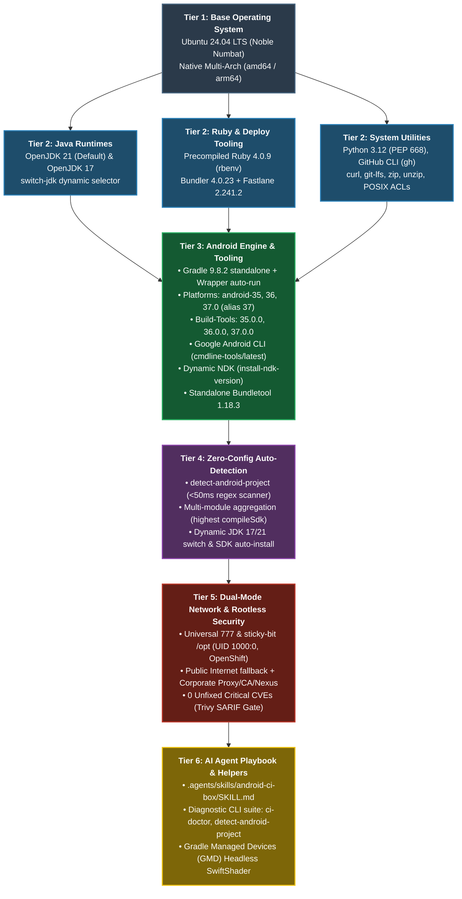
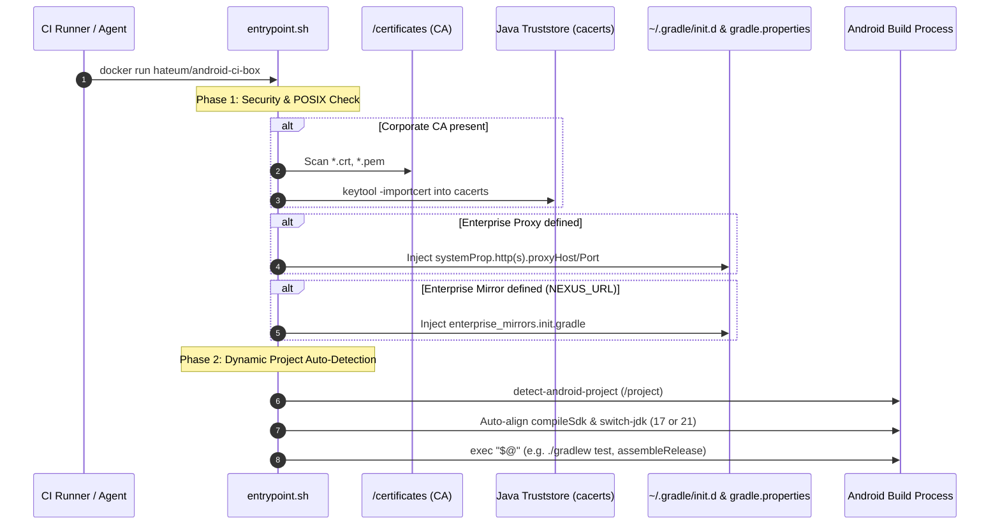
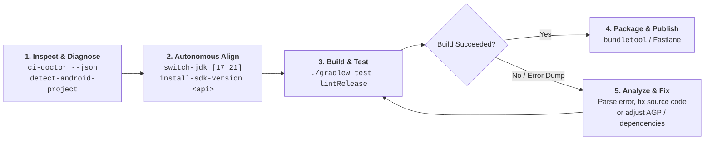

# Android CI/CD Build Box (`hateum/android-ci-box`)

[](https://hub.docker.com/r/hateum/android-ci-box)
[](https://hatem-noureddine.github.io/android-ci/)
[](https://hub.docker.com/r/hateum/android-ci-box)
[](https://github.com/hatem-noureddine/android-ci/security)
[](https://github.com/hatem-noureddine/android-ci/releases)
[](https://github.com/hatem-noureddine/android-ci/releases)
[](https://gradle.org)
[](https://developer.android.com)
[-ED8B00?style=flat-square&logo=openjdk)](https://openjdk.org)
[](https://fastlane.tools)
[](LICENSE)

A battle-tested, high-performance, and rootless Docker container engineered for **Android CI/CD automation** across **GitHub Actions**, **GitLab CI**, **Jenkins**, and **Bitbucket Pipelines**.

Features a **dual-mode network engine** (public internet & enterprise intranet with auto-proxy, custom CA certificates, and Nexus mirrors), **native multi-arch compilation** (`amd64` and `arm64`), and **zero-config dynamic auto-detection** of project SDK and Java toolchains.

---

## ⚖️ Why `hateum/android-ci-box`? (Feature Comparison)

| Capability | Standard Android CI Images | `hateum/android-ci-box` |
| :--- | :--- | :--- |
| **Silicon Architecture** | `x86_64` only (Emulated on ARM via slow QEMU) | **Native Multi-Arch (`amd64` + `arm64`)** (Full native silicon speed on Apple Silicon & AWS Graviton) |
| **Project Setup** | Manual SDK/JDK setup scripts per repo | **Zero-Config Dynamic Auto-Detection** (`compileSdk`, `buildTools`, Java 17/21) in <50ms |
| **Java Runtimes** | Single JDK version (fixed at build time) | **Dual-JDK (OpenJDK 21 + 17)** with instant CLI/Env toggle (`switch-jdk`) |
| **Security & Permissions**| Hardcoded `root` (fails on OpenShift/K8s) | **Universal Rootless (777 permissions)**, runs safely under any UID (`1000:0`, `1001:1001`) |
| **Vulnerability Audit** | Often contains unpatched high/critical CVEs | **Zero Unfixed Critical CVEs** (strictly audited via Trivy SARIF gates) |
| **Enterprise Network** | Custom Dockerfiles required for proxies & certs | **Auto-imported CA certs, automatic HTTP proxy & Nexus/Artifactory mirror derivation** |
| **Deployment Tools** | Slow `gem install fastlane` on every build | **Precompiled Ruby 4.0.9 + Fastlane 2.241.2** ready out-of-the-box in `/opt/rbenv` |
| **C/C++ NDK & CMake** | Missing or forces massive 4GB+ image size | **Dynamic On-Demand Engine (`install-ndk-version` & `INSTALL_NDK_VERSION`)** |
| **GitHub Action Integration** | Raw container scripting required | **Official Composite Action (`uses: hatem-noureddine/android-ci@v1`)** |
| **Build Performance Tuning** | Default Gradle daemon issues in Docker | **Auto-injected CI Optimization Init-Script (Parallel, Caching, VFS off)** |
| **Testing & Emulation** | Complex X11/VNC setup or broken display | **Native Gradle Managed Devices (GMD)** with SwiftShader Headless GPU acceleration |
| **Health Diagnostics** | No diagnostic tooling | **Built-in `ci-doctor` & `detect-android-project`** CLI utilities with JSON reporting |

---

## 🏛️ Architecture & 6-Tier Dependency Schema



### 🌐 Dual-Mode Network Engine Lifecycle



---

## ⚡ Quick Start by Developer Objective

### 1. Interactive Debugging & System Healthcheck
Verify container health, Java versions, SDK packages, and network connectivity in seconds:
```bash
# Run full interactive diagnostic with network connectivity probes
docker run --rm -v "$(pwd)":/project hateum/android-ci-box:latest ci-doctor

# Inspect project requirements vs installed components (<50ms)
docker run --rm -v "$(pwd)":/project hateum/android-ci-box:latest detect-android-project

# Launch interactive shell
docker run -it --rm -v "$(pwd)":/project -w /project hateum/android-ci-box:latest /bin/bash
```

### 2. Build Release APK and Android App Bundle (AAB)
Zero manual setup: the container auto-configures JDK and SDK matching your project:
```bash
# Build Release APK
docker run --rm \
  -v "$(pwd)":/project \
  -v "$HOME/.gradle":/home/runner/.gradle \
  -w /project \
  hateum/android-ci-box:latest \
  ./gradlew assembleRelease --no-daemon

# Build Release AAB and extract universal APK with Bundletool
docker run --rm \
  -v "$(pwd)":/project \
  -w /project \
  hateum/android-ci-box:latest \
  bash -c "./gradlew bundleRelease --no-daemon && \
    bundletool build-apks --bundle=app/build/outputs/bundle/release/app-release.aab --output=/tmp/app.apks --mode=universal"
```

### 3. Instrumented UI Testing: Gradle Managed Devices (GMD)
Native headless emulator execution with SwiftShader GPU acceleration and KVM support:
```bash
docker run --rm \
  --device /dev/kvm \
  -v "$(pwd)":/project \
  -w /project \
  hateum/android-ci-box:latest \
  ./gradlew pixel8api35DebugAndroidTest --no-daemon
```

### 4. Continuous Deployment with Fastlane
Deploy directly to Google Play Internal track without installing Ruby gems:
```bash
docker run --rm \
  -v "$(pwd)":/project \
  -w /project \
  -e SUPPLY_JSON_KEY_DATA="${PLAY_STORE_JSON_KEY}" \
  hateum/android-ci-box:latest \
  bundle exec fastlane android deploy_internal
```

---

## 🔍 Dynamic Auto-Detection & Cross-Compatibility Safeguards

The container includes a built-in static inspection engine (`detect-android-project`) executed by `entrypoint.sh` on startup:

1. **`compileSdk` Resolution**: Scans all sub-modules and selects the maximum target SDK. If missing from `/opt/android-sdk`, it auto-downloads it on-the-fly.
2. **`buildToolsVersion` Resolution**: Scans for explicit definitions or falls back to `${compileSdk}.0.0` (standard AGP behavior).
3. **Java Version Matching**: Selects OpenJDK 17 or 21 matching `jvmToolchain` or `JavaVersion.VERSION_XX`.
4. **Gradle ⇄ Java Compatibility Fallback**: If a project uses Gradle Wrapper < 8.5 (incompatible with Java 21), the container automatically switches to OpenJDK 17 to prevent build crashes.
5. **Air-Gapped Resiliency**: A 2-second network probe tests connectivity before downloading. If running offline, it warns and proceeds without freezing.

---

## 🎛️ CI Runtime Environment Variables

Explicit variables take **absolute precedence** over project auto-detection:

| Variable | Values / Format | Default | Purpose |
| :--- | :--- | :--- | :--- |
| `JAVA_VERSION` | `17`, `21` | `21` | Overrides active JDK (updates `JAVA_HOME` and symlinks). |
| `INSTALL_SDK_VERSION` | `33`, `34`, `35`, `36`, `37` | Auto-detected | Installs specified Android SDK platform if not present. |
| `INSTALL_BUILD_TOOLS` | `34.0.0`, `33.0.3`, ... | Auto-derived | Installs specified Android build-tools version. |
| `INSTALL_NDK_VERSION` | `27.2.12479018`, `26.1...` | Auto-detected | Installs specified Android NDK on-demand. |
| `INSTALL_CMAKE_VERSION` | `3.22.1`, `3.28...` | Auto-detected | Installs specified Android CMake on-demand. |
| `ENABLE_CI_OPTIMIZATIONS` | `true`, `false` | `true` | Enables/disables automatic Gradle CI parallel & build caching init-script. |
| `AUTO_DETECT_PROJECT` | `true`, `false` | `true` | Enables/disables static analysis of project build files. |
| `AUTO_INSTALL_SDK` | `true`, `false` | `true` | Allows/disallows on-the-fly downloading of missing SDK components. |
| `HTTP_PROXY` / `HTTPS_PROXY`| `http://proxy:8080` | *None* | Injected into `~/.gradle/gradle.properties` automatically. |
| `NO_PROXY` | `localhost,127.0.0.1,.corp` | *None* | Converted to Java pipe-delimited format for `gradle.properties`. |
| `NEXUS_URL` | `https://nexus.corp/repository`| *None* | Derives mirror hooks for Google, MavenCentral, GradlePortal. |
| `NEXUS_RUBY_URL` | `https://nexus.corp/rubygems` | Auto-derived | Configures Bundler and RubyGems mirror (auto-derived from `NEXUS_URL` if omitted). |
| `OFFLINE_MODE` | `true`, `false` | `false` | Opt-in: enforces strict offline build execution (`startParameter.offline=true`). |
| `CORPORATE_CA_URL` | URL string | *None* | Downloads and imports corporate SSL certificate on startup. |
| `INSECURE_CA_DOWNLOAD` | `true`, `false` | `false` | Disables TLS verification strictly during initial CA download if bootstrap cert is self-signed. |
| `GRADLE_BUILD_CACHE_URL` | URL string | *None* | Configures remote HTTP Gradle build caching in `init.d`. |

---

## 🛠️ CLI Utilities Reference

| Utility | Location | Usage Example | Purpose |
| :--- | :--- | :--- | :--- |
| `ci-doctor` | `/usr/local/bin/ci-doctor` | `ci-doctor [--summary \| --json]` | Complete system, Java, SDK, network, and project diagnostics. |
| `detect-android-project` | `/usr/local/bin/detect-android-project` | `detect-android-project [path] [--json]` | Ultra-fast (<50ms) static parser for compileSdk, buildTools, and JDK. |
| `switch-jdk` | `/usr/local/bin/switch-jdk` | `switch-jdk 17` or `source switch-jdk 21` | Seamlessly toggles between OpenJDK 17 and OpenJDK 21. |
| `install-sdk-version` | `/usr/local/bin/install-sdk-version` | `install-sdk-version 34` or `34.0.0` | Installs platforms or build-tools via Google Android CLI. |
| `install-ndk-version` | `/usr/local/bin/install-ndk-version` | `install-ndk-version 27.2.12479018 [cmake]` | Dynamically installs Android NDK and CMake with rootless permissions. |
| `bundletool` | `/usr/local/bin/bundletool` | `bundletool build-apks --bundle=app.aab` | Google Bundletool 1.18.3 CLI for universal APKs and testing. |
| `android` | `${ANDROID_HOME}/cmdline-tools/latest/bin/android` | `android sdk list`, `android --version` | Official Google Android CLI. |

---

## 🚀 CI/CD Pipeline Recipes

### 1. GitHub Actions (Official 1-Line Composite Action or Container Job)

#### Option A: Official GitHub Action (`uses: hatem-noureddine/android-ci@v1`)
```yaml
name: Android CI
on: [push, pull_request]

jobs:
  build:
    runs-on: ubuntu-latest
    steps:
      - uses: actions/checkout@v4
      - name: Build & Test Android App
        uses: hatem-noureddine/android-ci@v1
        with:
          run: |
            ci-doctor --summary
            ./gradlew lintRelease testReleaseUnitTest assembleRelease
```

#### Option B: Native Container Job (`container: image: hateum/android-ci-box:latest`)
```yaml
name: Android CI
on: [push, pull_request]

jobs:
  build:
    runs-on: ubuntu-24.04
    container:
      image: hateum/android-ci-box:latest
      options: --user 1000:0
    steps:
      - uses: actions/checkout@v4
      - uses: actions/cache@v4
        with:
          path: |
            ~/.gradle/caches
            ~/.gradle/wrapper
          key: ${{ runner.os }}-gradle-${{ hashFiles('**/*.gradle*') }}
      - name: Run Diagnostics & Lint
        run: |
          ci-doctor --summary
          ./gradlew lintRelease testReleaseUnitTest --no-daemon
      - name: Build Release Bundle
        run: ./gradlew bundleRelease --no-daemon
      - name: Fastlane Google Play Deploy (Optional)
        run: bundle exec fastlane android deploy_internal
        env:
          SUPPLY_JSON_KEY_DATA: ${{ secrets.PLAY_STORE_JSON_KEY }}
```

### 2. GitLab CI/CD (`.gitlab-ci.yml`)
```yaml
default:
  image: hateum/android-ci-box:latest
  before_script:
    - export GRADLE_USER_HOME="${CI_PROJECT_DIR}/.gradle"
  cache:
    key: ${CI_COMMIT_REF_SLUG}
    paths:
      - .gradle/caches/
      - .gradle/wrapper/

stages: [ test, build ]

lint_and_test:
  stage: test
  script:
    - ci-doctor --summary
    - ./gradlew lintRelease testReleaseUnitTest --no-daemon

build_aab:
  stage: build
  script:
    - ./gradlew bundleRelease --no-daemon
  artifacts:
    paths:
      - app/build/outputs/bundle/release/*.aab
```

### 3. Exhaustive CI/CD Recipes (Jenkins, Bitbucket, CircleCI, Azure DevOps)

Complete copy-pasteable configuration files are documented in our [CI/CD Integration Hub](docs/ci-integrations.md):
- [Jenkins Declarative Pipeline (`Jenkinsfile`)](docs/ci-integrations.md#3-jenkins-declarative-pipeline)
- [Bitbucket Pipelines (`bitbucket-pipelines.yml`)](docs/ci-integrations.md#4-bitbucket-pipelines)
- [CircleCI Docker Executor (`.circleci/config.yml`)](docs/ci-integrations.md#5-circleci)
- [Azure DevOps Pipelines (`azure-pipelines.yml`)](docs/ci-integrations.md#6-azure-devops-pipelines)

---

## 🤖 AI Agents & Autonomous Workflows

`hateum/android-ci-box` provides first-class support for **autonomous AI coding agents** (Antigravity, Claude Code, GitHub Copilot Workspace, Roo Code, Cursor):



- **Official Agent Skill**: Reference or include [`.agents/skills/android-ci-box/SKILL.md`](.agents/skills/android-ci-box/SKILL.md) in your agent configuration.
- **Embedded Helpers**: Agents invoke ultra-fast utilities (`ci-doctor`, `detect-android-project`, `switch-jdk`, `install-sdk-version`, `install-ndk-version`, `bundletool`) with zero manual prompt friction.
- **Full Guide**: See [AI Agent Autonomous Playbook](docs/ai-agents.md) for detailed protocols.

---

## 🌐 Enterprise & Corporate Intranet Setup

### 1. SSL Inspection & Custom Corporate CA Certificates
Mount your enterprise certificates (`.crt`, `.cer`, `.pem`) into `/certificates`:
```bash
docker run --rm \
  -v /path/to/corporate-ca.crt:/certificates/corp.crt \
  hateum/android-ci-box:latest ./gradlew assembleRelease
```
Certificates are automatically registered in the system truststore and Java `cacerts`.

### 2. Nexus / Artifactory Mirror Auto-Derivation
Pass your internal repository URL to redirect Google Maven and MavenCentral automatically:
```bash
docker run --rm \
  -e NEXUS_URL="https://nexus.corp.internal/repository" \
  -e NEXUS_USER="ci-builder" \
  -e NEXUS_PASSWORD="secretPassword123" \
  hateum/android-ci-box:latest ./gradlew assembleRelease
```

---

## 🔏 Supply Chain Security & Cryptographic Verification

All container images published to **GHCR** and **Docker Hub** are cryptographically signed with **Sigstore / Cosign** using keyless OpenID Connect (OIDC) identities, and include an in-toto **SPDX Software Bill of Materials (SBOM)** attestation ([ADR-0015](docs/adr/0015-supply-chain-security-cosign-and-sbom.md)).

### 1. Verify Image Signature (Cosign)
```bash
cosign verify ghcr.io/hatem-noureddine/android-ci-box:latest \
  --certificate-identity-regexp "https://github.com/hatem-noureddine/android-ci/" \
  --certificate-oidc-issuer "https://token.actions.githubusercontent.com"
```

### 2. Verify and Extract SPDX SBOM Attestation
```bash
cosign verify-attestation --type spdxjson ghcr.io/hatem-noureddine/android-ci-box:latest \
  --certificate-identity-regexp "https://github.com/hatem-noureddine/android-ci/" \
  --certificate-oidc-issuer "https://token.actions.githubusercontent.com" \
  | jq -r '.payload' | base64 -d | jq .
```
You can also download the raw `android-ci-box-<version>.spdx.json` directly from the [GitHub Releases](https://github.com/hatem-noureddine/android-ci/releases) page.

---

## ❓ FAQ & Troubleshooting

### 1. Can I run on OpenShift, Kubernetes, or hardened runners?
Yes. Universal read/write permissions (`777`) are set on `/project`, `/builds`, `/opt`, and `/home/runner/.gradle`, allowing execution under any UID (e.g. `--user 1000:0` or `--user 1001:1001`).

### 2. How to fix SSL `PKIX path building failed`?
Mount your corporate certificate into `/certificates`:
`docker run -v /path/to/corp-cert.crt:/certificates/corp.crt hateum/android-ci-box:latest ...`

### 3. What is the status of the Android Emulator on ARM64 Linux hosts?
Google compiles the Linux SDK Emulator (`emulator`) exclusively for `x86_64`. On ARM64 Linux hosts (e.g. AWS Graviton), compilation, linting, unit tests, and Fastlane run at native silicon speed, while headless emulator tests require an `x86_64` runner.

---

## 📄 License
This project is open-source software licensed under the [MIT License](LICENSE).
