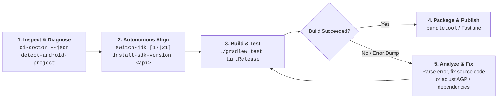

# AI Agents & Autonomous CI/CD Workflows

`hateum/android-ci-box` is the first Android build container built from the ground up for **autonomous AI agents** (Antigravity, Claude Code, GitHub Copilot Workspace, Roo Code, Cursor, Windsurf, etc.).

---

## 🤖 The Autonomous Agent Execution Loop

When an AI agent interacts with an Android project inside the container, it follows a deterministic closed-loop execution pattern:

---

## 🧰 Embedded Helper Matrix for Agents

Standard Android images require agents to write fragile multi-line shell scripts to switch JDKs or download SDK components. In `hateum/android-ci-box`, agents invoke purpose-built CLI helpers:

| Helper Utility | Location | Agent Purpose | Response Time |
| :--- | :--- | :--- | :--- |
| `ci-doctor` | `/usr/local/bin/ci-doctor` | Complete diagnostic probe (Java, Android SDK, KVM/GMD, Proxies, Mirrors). Emits human-readable or `--json` output. | <150ms |
| `detect-android-project` | `/usr/local/bin/detect-android-project` | Ultra-fast regex scanner detecting `compileSdk`, `buildTools`, and Java toolchains directly from Gradle files. | <50ms |
| `switch-jdk` | `/usr/local/bin/switch-jdk [17\|21]` | Dynamically toggles active `JAVA_HOME` and symlinks between OpenJDK 17 and OpenJDK 21 without restarting the container. | <20ms |
| `install-sdk-version` | `/usr/local/bin/install-sdk-version <api>` | Installs older or preview Android SDK platforms (e.g. `34`, `33`) using the Google Android CLI with sdkmanager fallback. | On-Demand |
| `install-ndk-version` | `/usr/local/bin/install-ndk-version <ndk> [cmake]` | Dynamically installs Android NDK and CMake with rootless universal permissions and `default` symlink. | On-Demand |
| `bundletool` | `/usr/local/bin/bundletool` | Standalone wrapper for Bundletool 1.18.3 to extract APKs, test feature splits, and validate app bundles. | <100ms |
| `android` | `${ANDROID_HOME}/cmdline-tools/latest/bin/android` | Official Google Android CLI tool (replacing legacy `sdkmanager` / `avdmanager`). | Native |

---

## 📄 Agent Skill Reference (`.agents/skills/android-ci-box/`)

The repository includes a production-ready AI Agent Skill at [`.agents/skills/android-ci-box/SKILL.md`](https://github.com/hatem-noureddine/android-ci/blob/main/.agents/skills/android-ci-box/SKILL.md).

### What the skill teaches AI agents:
1. **Zero Permission Leaks**: Always respect rootless execution (never attempt `sudo apt-get` inside running pipelines).
2. **KVM & Emulator Diagnostics**: How to query `/dev/kvm` and fall back gracefully to SwiftShader software GPU for headless tests.
3. **Multi-Arch Quirk Awareness**: Explains that Google's emulator package is native to `x86_64` (`amd64`), while unit tests and builds run natively on `arm64`.
4. **Diagnostic-First Protocol**: Instructs agents to run `ci-doctor` as step 1 to immediately identify root causes before attempting code changes.

### Adding the Skill to your AI Agent:
If your development environment supports agent skills (e.g. Antigravity, Claude Code, Copilot), simply reference or copy the `.agents/skills/android-ci-box/` folder into your project's agent skills directory.
