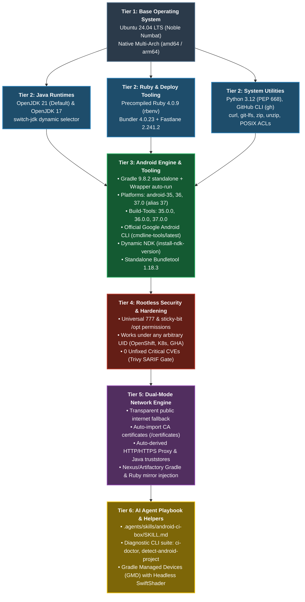
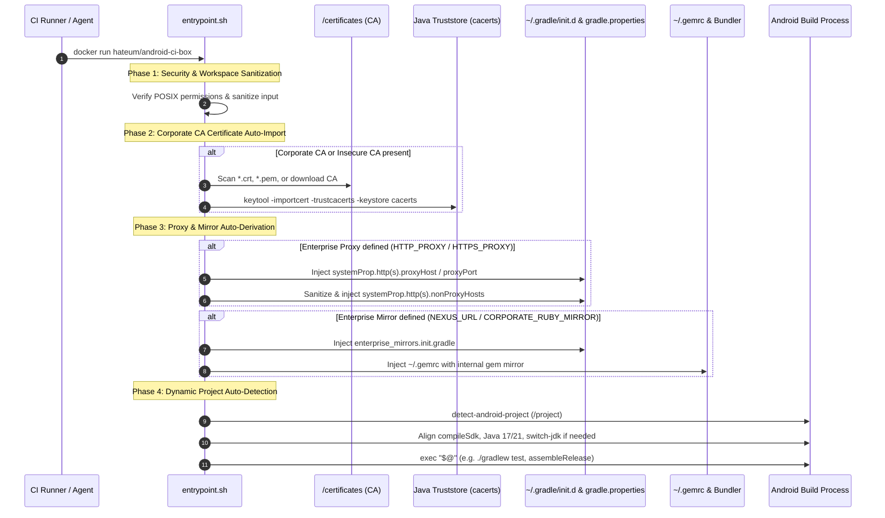
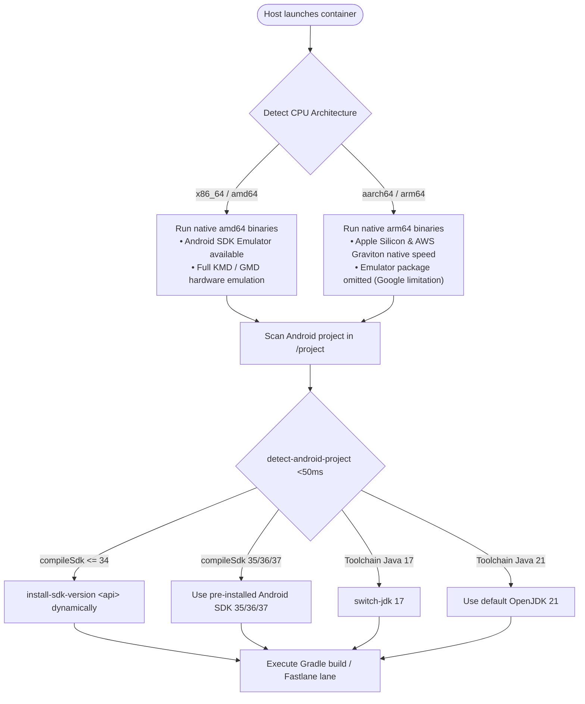
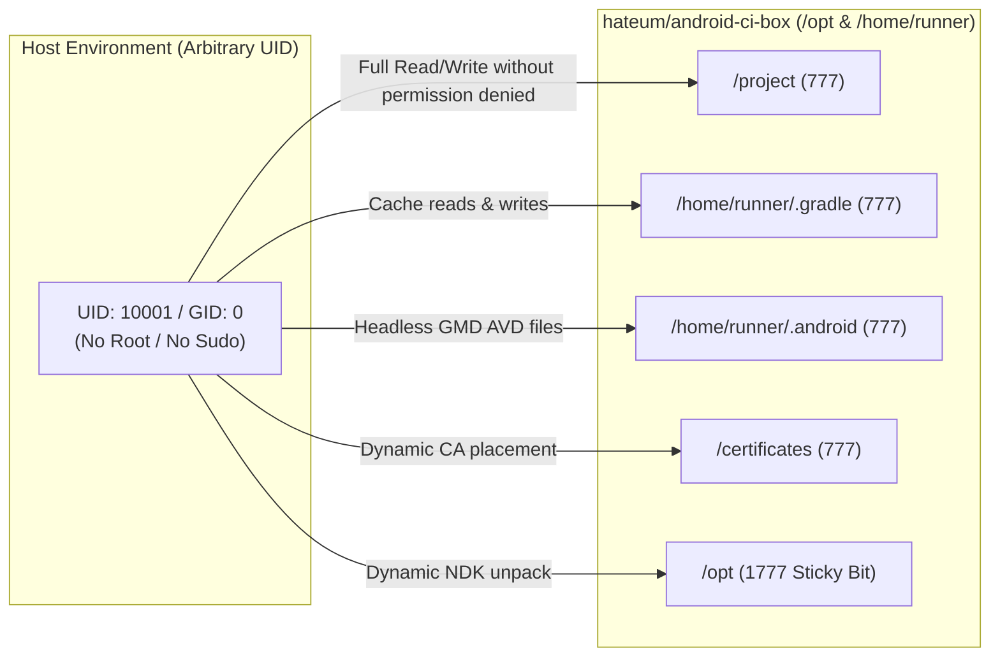

# Architecture & Technical Deep-Dive

This document details the internal design, multi-tier layout, network mechanics, and execution lifecycles of `hateum/android-ci-box`.

---

## 🏛️ 6-Tier Architecture Schema

The container is engineered as an immutable, optimized stack structured across 6 logical tiers:

---

## 🌐 Dual-Mode Network Engine Lifecycle

The container operates autonomously whether running on the open public internet or behind strict corporate proxies with private mirrors:

---

## ⚡ Native Multi-Arch & Dynamic Auto-Detection

---

## 🔒 Rootless POSIX Permissions Architecture

In Kubernetes, OpenShift, or hardened GitHub Actions runners, containers run under arbitrary UIDs (such as `10001:0` or `1001:1001`) with no `root` capabilities:

