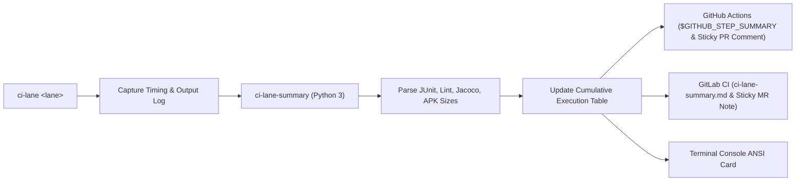

# Complete Turnkey Mobile CI/CD Guide (`ci-lane`)

`ci-lane` is an autonomous, turnkey Fastlane runner embedded directly inside `hateum/android-ci-box`.

It empowers mobile development teams to run complete **build, test, lint, code coverage, icon badging, keystore signing, store distribution, and multi-channel alerting workflows in a single line of CI code** — with **zero Fastfile or Ruby setup** required in their Android repository.

---

## ⚡ Key Highlights & Architecture

- **Zero Project Setup**: No `Gemfile`, no `fastlane/Fastfile`, no ruby or bundler commands needed in the Android repository.
- **Smart Dual-Routing**:
  - If your repository contains its own `fastlane/Fastfile`, `ci-lane` automatically delegates to your custom lanes.
  - If no Fastfile is present, `ci-lane` seamlessly runs the **universal built-in Fastfile** (`/opt/fastlane/Fastfile`).
- **360° Diagnostic Reporting**: Automatically parses JUnit XML, Lint reports, Jacoco coverage, and APK sizes, injecting live executive summaries into **GitHub Actions (`$GITHUB_STEP_SUMMARY`)**, **GitLab CI artifacts (`ci-lane-summary.md`)**, and **Sticky PR/MR comments**.
- **Complete Multi-Store Support**: First-class distribution to Google Play Console (multi-track), Firebase App Distribution, Microsoft App Center, Huawei AppGallery, and Samsung Galaxy Store.

---

## 📖 Complete Directory of Built-in Lanes (25+ Lanes)

Run `ci-lane list` inside any container to inspect the live catalog.

### 1. Quality, Testing & Security Lanes

#### `ci-lane test`
- **Purpose**: Executes JUnit unit tests across all project modules (`./gradlew test`).
- **Outputs**: Test XML reports parsed automatically into the CI Summary table.
- **Environment Variables**: None required.
- **Example**: `ci-lane test`

#### `ci-lane lint`
- **Purpose**: Runs Android Lint static analysis (`./gradlew lint lintRelease`).
- **Outputs**: `app/build/reports/lint-results-release.html` and `.xml`.
- **Environment Variables**: None required.
- **Example**: `ci-lane lint`

#### `ci-lane detekt`
- **Purpose**: Runs Detekt Kotlin code smells and complexity analysis (`./gradlew detekt`).
- **Outputs**: Detekt report in `build/reports/detekt/`. Non-fatal notice if Detekt is not configured in the target project.
- **Example**: `ci-lane detekt`

#### `ci-lane sonar`
- **Purpose**: Submits source code analysis to SonarQube or SonarCloud (`./gradlew sonar`).
- **Environment Variables**:
  - `SONAR_TOKEN` (*Required*): Sonar user or project token.
  - `SONAR_HOST_URL` (*Optional*): Target Sonar server URL (default: `https://sonarcloud.io`).
- **Example**: `SONAR_TOKEN="$SONAR_TOKEN" ci-lane sonar`

#### `ci-lane screenshot_tests`
- **Purpose**: Verifies Jetpack Compose UI screenshot regression tests using **Roborazzi** or **Paparazzi** (`verifyRoborazziDebug` or `verifyPaparazziDebug`).
- **Example**: `ci-lane screenshot_tests`

#### `ci-lane code_coverage`
- **Purpose**: Runs Jacoco code coverage (`./gradlew jacocoTestReport`), computes overall line coverage %, and fails the build if below threshold.
- **Environment Variables**:
  - `COVERAGE_THRESHOLD` (*Optional*): Minimum required line coverage percentage (default: `80`).
- **Example**: `COVERAGE_THRESHOLD=75 ci-lane code_coverage`

#### `ci-lane security_scan`
- **Purpose**: Audits compiled APKs/AABs for security vulnerabilities:
  - Detects dangerous runtime permissions (Contacts, SMS, Fine Location, Microphone, Camera, Storage).
  - Inspects APK signing certificate validity dates and expiration.
- **Prerequisite**: Run after `build_release` or `bundle`.
- **Example**: `ci-lane security_scan`

#### `ci-lane perf_baseline`
- **Purpose**: Runs Jetpack Macrobenchmark instrumented tests and extracts frame timing, cold start, and jank metrics into an aggregated JSON report.
- **Environment Variables**:
  - `BENCHMARK_MODULE` (*Optional*): Benchmark Gradle module name (default: `benchmarks`).
  - `BENCHMARK_CLASS` (*Optional*): Specific test class to target.
  - `BENCHMARK_OUTPUT` (*Optional*): Destination directory for JSON report (default: `build/benchmark-results`).
- **Example**: `BENCHMARK_MODULE="macrobenchmark" ci-lane perf_baseline`

---

### 2. Packaging, Branding & Artifact Auditing

#### `ci-lane build_debug`
- **Purpose**: Compiles debug APK (`./gradlew assembleDebug`).
- **Outputs**: `app/build/outputs/apk/debug/app-debug.apk`.
- **Example**: `ci-lane build_debug`

#### `ci-lane build_release`
- **Purpose**: Compiles unsigned or signed release APK (`./gradlew assembleRelease`).
- **Outputs**: `app/build/outputs/apk/release/app-release.apk`.
- **Example**: `ci-lane build_release`

#### `ci-lane bundle`
- **Purpose**: Compiles standard production Android App Bundle (`./gradlew bundleRelease`).
- **Outputs**: `app/build/outputs/bundle/release/app-release.aab`.
- **Example**: `ci-lane bundle`

#### `ci-lane badge`
- **Purpose**: Dynamically overlays a visual QA/Beta/Dev banner onto app launcher icons (`ic_launcher.png`) before compilation using high-performance Python PIL.
- **Environment Variables**:
  - `BADGE_TEXT` (*Optional*): Text displayed on the badge ribbon (default: `BETA`).
  - `BADGE_COLOR` (*Optional*): Hex color for badge background (default: `#FF5722`).
  - `BADGE_GRAVITY` (*Optional*): Position: `bottom` or `top` (default: `bottom`).
- **Example**: `BADGE_TEXT="QA-42" BADGE_COLOR="#E91E63" ci-lane badge`

#### `ci-lane apk_size_audit`
- **Purpose**: Audits the size of compiled APK/AAB artifacts and warns if size exceeds a baseline or percentage limit.
- **Environment Variables**:
  - `APK_SIZE_BASELINE_MB` (*Optional*): Reference size in MB from previous stable release (e.g. `12.5`).
  - `APK_SIZE_WARN_THRESHOLD_PCT` (*Optional*): Percentage increase triggering a warning (default: `10` for +10%).
  - `APK_SIZE_WARN_THRESHOLD_MB` (*Optional*): Hard ceiling size limit in MB (e.g. `25`).
- **Example**: `APK_SIZE_BASELINE_MB=12.0 APK_SIZE_WARN_THRESHOLD_PCT=5 ci-lane apk_size_audit`

---

### 3. Keystore Signing & Security

#### `ci-lane sign`
- **Purpose**: Decodes base64-encoded keystore files, signs release APKs or AABs with `apksigner`, and sets signing properties.
- **Environment Variables**:
  - `KEYSTORE_BASE64` (*Required if no KEYSTORE_PATH*): Base64-encoded JKS/Keystore string.
  - `KEYSTORE_PATH` (*Optional*): Direct filesystem path to keystore (default: `/tmp/keystore.jks`).
  - `KEYSTORE_PASSWORD` (*Required*): Keystore storepass.
  - `KEY_ALIAS` (*Required*): Key alias name.
  - `KEY_PASSWORD` (*Optional*): Alias password (defaults to `KEYSTORE_PASSWORD`).
- **Example**:
  ```bash
  KEYSTORE_BASE64="$PROD_KEYSTORE_B64" \
  KEYSTORE_PASSWORD="$STORE_PASS" \
  KEY_ALIAS="$ALIAS" \
  ci-lane sign
  ```

---

### 4. Store Distribution Lanes

#### `ci-lane distribute_firebase`
- **Purpose**: Deploys release APK or AAB to **Firebase App Distribution**.
- **Environment Variables**:
  - `FIREBASE_APP_ID` (*Required*): Firebase Android App ID (e.g. `1:123456789:android:abcdef`).
  - `FIREBASE_TOKEN` (*Required*): Firebase CLI authentication token.
  - `FIREBASE_GROUPS` (*Optional*): Tester groups comma-separated (default: `testers`).
  - `FIREBASE_RELEASE_NOTES` (*Optional*): Release changelog or notes.
- **Example**:
  ```bash
  FIREBASE_APP_ID="1:123456789:android:abcdef" \
  FIREBASE_TOKEN="$FIREBASE_CLI_TOKEN" \
  FIREBASE_GROUPS="internal-qa,beta-testers" \
  ci-lane distribute_firebase
  ```

#### `ci-lane distribute_playstore`
- **Purpose**: Uploads release AAB to **Google Play Console** using Fastlane Supply.
- **Environment Variables**:
  - `GOOGLE_PLAY_KEY_BASE64` or `SUPPLY_JSON_KEY` (*Required*): Base64 service account JSON key or path.
  - `PLAY_TRACK` (*Optional*): Track name: `internal`, `alpha`, `beta`, or `production` (default: `internal`).
  - `PLAY_ROLLOUT_PERCENTAGE` (*Optional*): Staged rollout percentage `1` to `100` (default: `100`).
- **Example**:
  ```bash
  GOOGLE_PLAY_KEY_BASE64="$PLAY_STORE_JSON_B64" \
  PLAY_TRACK="beta" \
  PLAY_ROLLOUT_PERCENTAGE="20" \
  ci-lane distribute_playstore
  ```

#### `ci-lane deploy_alpha`
- **Purpose**: Convenience shortcut for deploying to Google Play **internal / alpha track** (`PLAY_TRACK=internal`).
- **Example**: `GOOGLE_PLAY_KEY_BASE64="$PLAY_STORE_JSON_B64" ci-lane deploy_alpha`

#### `ci-lane deploy_production`
- **Purpose**: Convenience shortcut for deploying to Google Play **production track** with configurable staged rollout.
- **Environment Variables**: `PLAY_ROLLOUT_PERCENTAGE` (default: `10` for 10% rollout).
- **Example**: `GOOGLE_PLAY_KEY_BASE64="$PLAY_STORE_JSON_B64" PLAY_ROLLOUT_PERCENTAGE=25 ci-lane deploy_production`

#### `ci-lane app_center`
- **Purpose**: Distributes release APK/AAB to **Microsoft App Center**.
- **Environment Variables**:
  - `APPCENTER_API_TOKEN` (*Required*): App Center API token.
  - `APPCENTER_OWNER_NAME` (*Required*): Organization or owner name.
  - `APPCENTER_APP_NAME` (*Required*): Registered App Center application name.
  - `APPCENTER_DISTRIBUTE_GROUP` (*Optional*): Destination group (default: `Testers`).
  - `APPCENTER_RELEASE_NOTES` (*Optional*): Release description.
- **Example**:
  ```bash
  APPCENTER_API_TOKEN="$TOKEN" \
  APPCENTER_OWNER_NAME="my-org" \
  APPCENTER_APP_NAME="MyAndroidApp" \
  ci-lane app_center
  ```

#### `ci-lane deploy_huawei`
- **Purpose**: Publishes AAB/APK to **Huawei AppGallery Connect** via REST API (essential for devices without Google Mobile Services).
- **Environment Variables**:
  - `HUAWEI_CLIENT_ID` (*Required*): AppGallery Connect Client ID.
  - `HUAWEI_CLIENT_SECRET` (*Required*): AppGallery Connect Client Secret.
  - `HUAWEI_APP_ID` (*Required*): Huawei Application ID.
- **Example**:
  ```bash
  HUAWEI_CLIENT_ID="$HUAWEI_ID" \
  HUAWEI_CLIENT_SECRET="$HUAWEI_SECRET" \
  HUAWEI_APP_ID="$HUAWEI_APP_ID" \
  ci-lane deploy_huawei
  ```

#### `ci-lane deploy_samsung`
- **Purpose**: Uploads APK/AAB to **Samsung Galaxy Store** via Seller Portal API.
- **Environment Variables**:
  - `SAMSUNG_SERVICE_ACCOUNT` (*Required*): Samsung Seller Account email.
  - `SAMSUNG_ACCESS_KEY` (*Required*): Samsung API Access Key.
  - `SAMSUNG_CONTENT_ID` (*Required*): Application Content ID in Seller Portal.
- **Example**:
  ```bash
  SAMSUNG_SERVICE_ACCOUNT="$SAMSUNG_ACCT" \
  SAMSUNG_ACCESS_KEY="$SAMSUNG_KEY" \
  SAMSUNG_CONTENT_ID="$SAMSUNG_CID" \
  ci-lane deploy_samsung
  ```

#### `ci-lane distribute_github`
- **Purpose**: Attaches compiled release artifacts (APK and AAB) to a **GitHub Release** via `gh` CLI.
- **Environment Variables**: `GITHUB_REF_NAME` or `CI_COMMIT_TAG` (release tag to attach to).
- **Example**: `ci-lane distribute_github`

---

### 5. Version Control & Release Automation

#### `ci-lane changelog`
- **Purpose**: Parses Git commit history from the latest tag up to `HEAD` using **Conventional Commits** (`feat:`, `fix:`, `perf:`, `refactor:`, `docs:`) and prepends a formatted release section to `CHANGELOG.md`.
- **Environment Variables**: `CHANGELOG_FILE` (default: `CHANGELOG.md`).
- **Example**: `ci-lane changelog`

#### `ci-lane git_tag`
- **Purpose**: Extracts `versionName` from `app/build.gradle` (or `build.gradle.kts`), creates Git tag `vX.Y.Z`, and pushes it to `origin`.
- **Environment Variables**: `GIT_TAG_NAME` (*Optional override*, e.g. `v2.4.0-rc1`).
- **Example**: `ci-lane git_tag`

---

### 6. ChatOps & Alerting Lanes

#### `ci-lane notify_slack`
- **Purpose**: Sends formatted build status card to **Slack**.
- **Environment Variables**: `SLACK_WEBHOOK_URL` (*Required*), `SLACK_CHANNEL` (*Optional*).
- **Example**: `SLACK_WEBHOOK_URL="$SLACK_URL" ci-lane notify_slack`

#### `ci-lane notify_teams`
- **Purpose**: Sends adaptive card to **Microsoft Teams**.
- **Environment Variables**: `TEAMS_WEBHOOK_URL` (*Required*).
- **Example**: `TEAMS_WEBHOOK_URL="$TEAMS_URL" ci-lane notify_teams`

#### `ci-lane notify`
- **Purpose**: Smart multi-channel broadcast. Dispatches notifications to **Slack**, **MS Teams**, **Discord**, and **Telegram** simultaneously based on available webhook variables.
- **Environment Variables**: `SLACK_WEBHOOK_URL`, `TEAMS_WEBHOOK_URL`, `DISCORD_WEBHOOK_URL`, `TELEGRAM_BOT_TOKEN`, `TELEGRAM_CHAT_ID`.
- **Example**: `ci-lane notify`

---

### 7. Composite End-to-End Pipelines

#### `ci-lane all`
- **Purpose**: Complete quality and compilation pipeline in one command:
  `lint` ➔ `detekt` ➔ `test` ➔ `build_release` ➔ `bundle`.
- **Example**: `ci-lane all`

#### `ci-lane release`
- **Purpose**: Complete zero-touch release sequence:
  `sign` ➔ `bundle` ➔ `changelog` ➔ `distribute_playstore` ➔ `distribute_firebase` ➔ `git_tag` ➔ `notify`.
- **Example**: `ci-lane release`

#### `ci-lane clean`
- **Purpose**: Cleans Gradle caches, project build directories, and terminates background daemons (`./gradlew clean`).
- **Example**: `ci-lane clean`

---

## 📊 Universal CI Summary & Sticky PR/MR Reporting

After each lane completes, `ci-lane` automatically triggers the **Diagnostic 360° Reporter** (`ci-lane-summary`):



### Reporter Controls
| Variable | Default | Purpose |
| :--- | :--- | :--- |
| `CI_LANE_SUMMARY` | `true` | Set `false` to disable summary generation. |
| `CI_LANE_COMMENT_PR` | `true` | Set `false` to disable sticky comments on Pull / Merge Requests. |
| `CI_LANE_FAIL_SILENT` | `false` | Set `true` to suppress non-zero exit codes (not recommended in CI). |

---

## 🛠️ Complete GitHub Actions Integration Guide

### How to Configure Secrets in GitHub Repository
Navigate to **Settings ➔ Secrets and variables ➔ Actions** and add:
- `PROD_KEYSTORE_B64`: Base64 string of your `.jks` (`base64 -w 0 release.jks | pbcopy`).
- `KEYSTORE_PASSWORD` & `KEY_ALIAS`: Keystore credentials.
- `PLAY_STORE_JSON_B64`: Base64 string of Google Play service account JSON key.
- `FIREBASE_APP_ID` & `FIREBASE_CLI_TOKEN`: Firebase credentials.
- `SLACK_WEBHOOK_URL`: Slack Incoming Webhook URL.

---

### Workflow 1: Pull Request Verification (`.github/workflows/pr-check.yml`)

```yaml
name: Pull Request Quality Gate

on:
  pull_request:
    branches: [ main, develop ]

jobs:
  quality-check:
    runs-on: ubuntu-24.04
    container:
      image: hateum/android-ci-box:slim
    permissions:
      contents: read
      pull-requests: write # Required for sticky PR comment

    steps:
      - uses: actions/checkout@v4

      - name: Cache Gradle Packages
        uses: actions/cache@v4
        with:
          path: |
            ~/.gradle/caches
            ~/.gradle/wrapper
          key: ${{ runner.os }}-gradle-${{ hashFiles('**/*.gradle*', '**/gradle-wrapper.properties') }}

      - name: Run Quality Suite
        run: |
          ci-lane lint
          ci-lane test
          ci-lane code_coverage
        env:
          COVERAGE_THRESHOLD: "80"
          GITHUB_TOKEN: ${{ secrets.GITHUB_TOKEN }}
```

---

### Workflow 2: Nightly QA & Firebase Distribution (`.github/workflows/nightly-beta.yml`)

```yaml
name: Nightly QA Deployment

on:
  push:
    branches: [ develop ]

jobs:
  build-and-distribute:
    runs-on: ubuntu-24.04
    container:
      image: hateum/android-ci-box:slim

    steps:
      - uses: actions/checkout@v4

      - name: Badge Launcher Icons & Compile Release
        run: |
          ci-lane badge
          ci-lane build_release
          ci-lane sign
          ci-lane apk_size_audit
          ci-lane distribute_firebase
          ci-lane notify_slack
        env:
          BADGE_TEXT: "QA-${{ github.run_number }}"
          BADGE_COLOR: "#FF5722"
          KEYSTORE_BASE64: ${{ secrets.PROD_KEYSTORE_B64 }}
          KEYSTORE_PASSWORD: ${{ secrets.KEYSTORE_PASSWORD }}
          KEY_ALIAS: ${{ secrets.KEY_ALIAS }}
          FIREBASE_APP_ID: ${{ secrets.FIREBASE_APP_ID }}
          FIREBASE_TOKEN: ${{ secrets.FIREBASE_CLI_TOKEN }}
          FIREBASE_GROUPS: "internal-testers"
          SLACK_WEBHOOK_URL: ${{ secrets.SLACK_WEBHOOK_URL }}
```

---

### Workflow 3: Production Store Release (`.github/workflows/store-release.yml`)

```yaml
name: Production Google Play Release

on:
  push:
    tags:
      - 'v*.*.*'

jobs:
  publish-stores:
    runs-on: ubuntu-24.04
    container:
      image: hateum/android-ci-box:slim
    permissions:
      contents: write # For GitHub Release and git tagging

    steps:
      - uses: actions/checkout@v4
        with:
          fetch-depth: 0 # Required for changelog Conventional Commits

      - name: Run Full Release Pipeline
        run: ci-lane release
        env:
          KEYSTORE_BASE64: ${{ secrets.PROD_KEYSTORE_B64 }}
          KEYSTORE_PASSWORD: ${{ secrets.KEYSTORE_PASSWORD }}
          KEY_ALIAS: ${{ secrets.KEY_ALIAS }}
          GOOGLE_PLAY_KEY_BASE64: ${{ secrets.PLAY_STORE_JSON_B64 }}
          PLAY_TRACK: "production"
          PLAY_ROLLOUT_PERCENTAGE: "10"
          SLACK_WEBHOOK_URL: ${{ secrets.SLACK_WEBHOOK_URL }}
          GITHUB_TOKEN: ${{ secrets.GITHUB_TOKEN }}
```

---

## 🦊 Complete GitLab CI Integration Guide (`.gitlab-ci.yml`)

### How to Configure GitLab CI/CD Variables
In **Settings ➔ CI/CD ➔ Variables**:
1. Check **Mask variable** for all credentials (`KEYSTORE_PASSWORD`, `FIREBASE_TOKEN`, etc.).
2. Set `PROD_KEYSTORE_B64` with the base64 output of your keystore:
   ```bash
   base64 -w 0 my-release-key.jks
   ```
3. Set `GOOGLE_PLAY_JSON_B64` with the base64 output of your Google Play service account JSON key.

---

### Production `.gitlab-ci.yml` Pipeline

```yaml
stages:
  - quality
  - branding
  - build
  - distribute
  - release

default:
  image: hateum/android-ci-box:slim
  before_script:
    - export GRADLE_USER_HOME="${CI_PROJECT_DIR}/.gradle"
  cache:
    key: ${CI_COMMIT_REF_SLUG}
    paths:
      - .gradle/caches/
      - .gradle/wrapper/

# ------------------------------------------------------------------------------
# 1. Quality & Linting
# ------------------------------------------------------------------------------
lint_and_unit_tests:
  stage: quality
  script:
    - ci-lane lint
    - ci-lane test
    - ci-lane code_coverage
  artifacts:
    when: always
    reports:
      junit: app/build/test-results/testReleaseUnitTest/*.xml
    paths:
      - build/reports/ci-lane-summary.md
      - ci-lane-summary.md
      - app/build/reports/lint-results-release.html

# ------------------------------------------------------------------------------
# 2. Beta / QA Badging & Firebase Distribution
# ------------------------------------------------------------------------------
deploy_firebase_beta:
  stage: distribute
  only:
    - develop
  script:
    - ci-lane badge
    - ci-lane build_release
    - ci-lane sign
    - ci-lane distribute_firebase
    - ci-lane notify_slack
  variables:
    BADGE_TEXT: "QA-${CI_PIPELINE_IID}"
    BADGE_COLOR: "#4CAF50"
    KEYSTORE_BASE64: "$PROD_KEYSTORE_B64"
    KEYSTORE_PASSWORD: "$KEYSTORE_PASSWORD"
    KEY_ALIAS: "$KEY_ALIAS"
    FIREBASE_APP_ID: "$FIREBASE_APP_ID"
    FIREBASE_TOKEN: "$FIREBASE_CLI_TOKEN"
    FIREBASE_GROUPS: "internal-testers"
    SLACK_WEBHOOK_URL: "$SLACK_WEBHOOK_URL"
  artifacts:
    when: always
    paths:
      - ci-lane-summary.md
      - app/build/outputs/apk/release/*.apk

# ------------------------------------------------------------------------------
# 3. Production Google Play Store Release
# ------------------------------------------------------------------------------
deploy_production_playstore:
  stage: release
  only:
    - tags
  script:
    - ci-lane changelog
    - ci-lane bundle
    - ci-lane sign
    - ci-lane security_scan
    - ci-lane apk_size_audit
    - ci-lane deploy_production
    - ci-lane notify
  variables:
    KEYSTORE_BASE64: "$PROD_KEYSTORE_B64"
    KEYSTORE_PASSWORD: "$KEYSTORE_PASSWORD"
    KEY_ALIAS: "$KEY_ALIAS"
    GOOGLE_PLAY_KEY_BASE64: "$GOOGLE_PLAY_JSON_B64"
    PLAY_ROLLOUT_PERCENTAGE: "10"
    APK_SIZE_BASELINE_MB: "14.0"
    SLACK_WEBHOOK_URL: "$SLACK_WEBHOOK_URL"
    TEAMS_WEBHOOK_URL: "$TEAMS_WEBHOOK_URL"
  artifacts:
    when: always
    paths:
      - ci-lane-summary.md
      - CHANGELOG.md
      - app/build/outputs/bundle/release/*.aab
```

---

## ❓ FAQ & Troubleshooting

### 1. Can I override a built-in lane with my own Fastfile?
Yes. If `fastlane/Fastfile` or `Fastfile` is present in your project root, `ci-lane` detects it automatically and delegates directly to your custom lane.

### 2. How do I disable the PR/MR sticky comment?
Pass `CI_LANE_COMMENT_PR="false"` in your workflow environment variables.

### 3. How do I base64-encode my Android Keystore for CI?
```bash
# macOS
base64 -i my-release-key.jks | pbcopy

# Linux
base64 -w 0 my-release-key.jks
```
Paste the resulting string directly into your CI secrets as `KEYSTORE_BASE64`.
